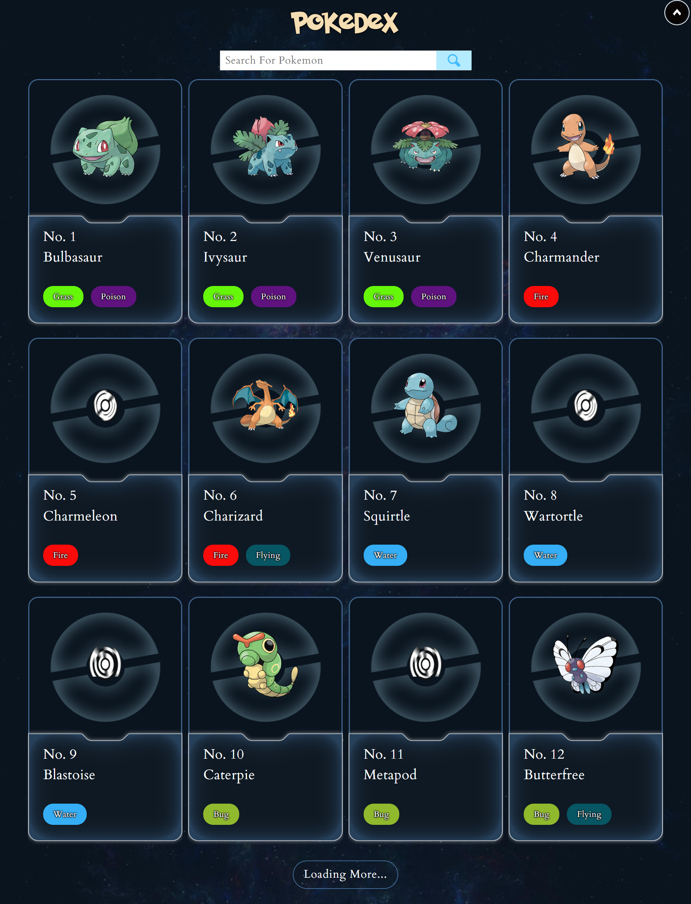
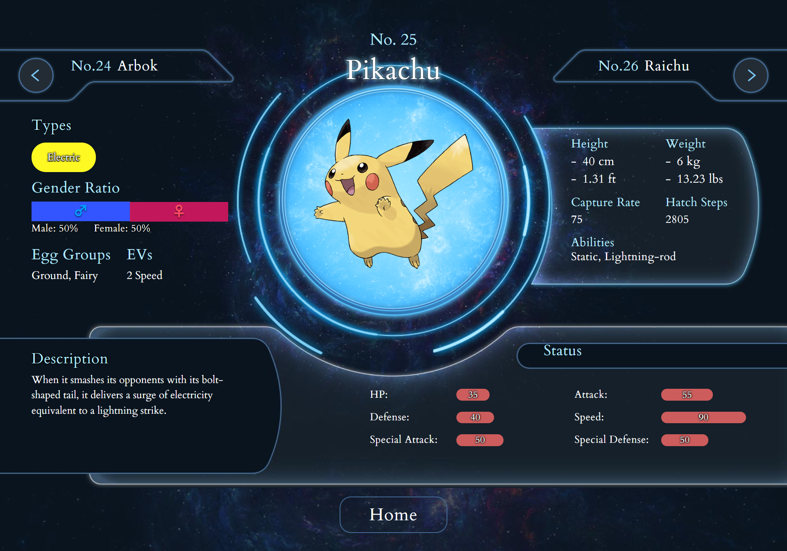

# Pokedex Fullstack Web Application

A modern **full-stack Pokédex** built with **Next.js** and a **Node.js / Express + MongoDB** REST API.  
This project helps users **search, browse, and explore all 898 Pokémon** with a clean and responsive interface.

---

<p align="center">
  <a href="screenshots/sc1.png" target="_blank">
    
  </a>
  <a href="screenshots/sc2.png" target="_blank">
    
  </a>
</p>

---

## 🚀 Features

- 🔍 **Search & Filter** — As-you-type suggestions with thumbnails; press Enter to filter the grid by name.  
- 📖 **Detailed Info Pages** — Base stats, types, abilities, gender ratio, egg groups, EVs, size, capture rate, and description, with prev/next navigation between Pokémon.  
- ⚡ **Optimized Performance** — The whole Pokédex loads in a single compressed request and is cached on the client, so browsing, searching, and navigating trigger no further API calls.  
- 🖼️ **Fast Image Delivery** — Artwork is served from Cloudflare R2 and lazy-loaded with placeholders; prev/next artwork is preloaded on detail pages.  
- 🎨 **Modern UI/UX** — Responsive Tailwind CSS layout with "Load More" pagination, scroll restoration, and smooth stat-bar transitions.  
- 🌐 **Custom REST API** — Express 5 + MongoDB with Zod validation, consistent JSON responses, Helmet, a CORS allowlist, and CDN-friendly caching.  
- 🩺 **Health Check & Keep-Alive** — `/health` performs a real database read, and a scheduled job keeps a free-tier MongoDB Atlas cluster from auto-pausing.  
- 🧪 **Tested** — API and model tests with Vitest and Supertest against an in-memory MongoDB.  

---

## 🛠️ Tech Stack

- **Frontend:** Next.js 15 (App Router, Turbopack), React 19, TypeScript, Tailwind CSS v4  
- **Data & State:** TanStack Query v5, Zustand, Axios  
- **Backend:** Node.js, Express 5, TypeScript, Zod, Helmet  
- **Database & Storage:** MongoDB Atlas (Mongoose), Cloudflare R2  
- **Testing:** Vitest, Supertest, mongodb-memory-server  
- **Deployment:** Docker, Railway (API), Vercel (frontend)  

---

## 📁 Project Structure

```
pokedex-fullstack/
├── backend/                # Express + MongoDB REST API
│   ├── scripts/            # Download artwork & upload it to Cloudflare R2
│   └── src/
│       ├── config/         # Env, DB connection, CORS, keep-alive job
│       ├── controllers/    # Route handlers
│       ├── middleware/     # Zod validation, error handling
│       ├── models/         # Mongoose Pokémon schema
│       ├── routes/         # /api/pokemon routes
│       └── tests/          # Vitest + Supertest specs
├── frontend/               # Next.js app
│   ├── public/             # Fonts and UI images
│   └── src/
│       ├── app/            # Pages: home, /pokemon/[id], error, 404
│       ├── services/       # API client
│       ├── shared/         # Query hooks, selectors, shared components
│       └── stores/         # Zustand store
└── screenshots/            # README images
```

---

## 📦 Installation

**Prerequisites:** Node.js 20.19+ and a MongoDB database (e.g. a free [MongoDB Atlas](https://www.mongodb.com/atlas) cluster).

1. Clone the repository:
   ```bash
   git clone https://github.com/nithasp/pokedex-fullstack
   ```

2. Navigate to the project directory:
   ```bash
   cd pokedex-fullstack
   ```

3. Set up and start the backend (runs at `http://localhost:4000`):
   ```bash
   cd backend
   npm install
   cp .env.example .env   # then fill in MONGO_URI and R2_PUBLIC_URL
   npm run dev
   ```

4. In a second terminal, install the frontend dependencies:
   ```bash
   cd frontend
   npm install
   ```

5. Create `frontend/.env.development` pointing at the local API:
   ```env
   NEXT_PUBLIC_API_URL=http://localhost:4000/api/pokemon
   ```

6. Start the frontend development server:
   ```bash
   npm run dev
   ```

7. Open your browser at:
   ```bash
   http://localhost:3000
   ```

> [!NOTE]
> The repository doesn't include a database seed. The API reads from the `pokemonList` collection — one document per Pokémon, with `_id` set to its National Pokédex number (1–898). See [`backend/src/models/pokemon.ts`](backend/src/models/pokemon.ts) for the document shape.

---

## ⚙️ Environment Variables

### Backend — `backend/.env`

| Variable | Default | Description |
| --- | --- | --- |
| `MONGO_URI` | — | **Required.** MongoDB connection string |
| `PORT` | `4000` | Port the API listens on |
| `NODE_ENV` | `development` | Runtime environment |
| `CORS_ORIGIN` | `*` | Comma-separated list of allowed origins |
| `R2_PUBLIC_URL` | — | Public base URL of the image bucket. If unset, the API returns `image: null` |
| `IMAGE_EXTENSION` | `webp` | Extension of the images in the bucket — set to `png` if you uploaded them with `scripts/upload-images-to-r2.js` |
| `KEEP_ALIVE_INTERVAL_HOURS` | `12` | How often to read from MongoDB to prevent Atlas auto-pause (`0` disables it) |
| `R2_ENDPOINT`, `R2_ACCESS_KEY_ID`, `R2_SECRET_ACCESS_KEY`, `R2_BUCKET` | — | Only needed to run `scripts/upload-images-to-r2.js` |

### Frontend — `frontend/.env.development` / `frontend/.env.production`

| Variable | Default | Description |
| --- | --- | --- |
| `NEXT_PUBLIC_API_URL` | — | **Required.** Base URL of the Pokémon API, e.g. `http://localhost:4000/api/pokemon` |
| `NEXT_PUBLIC_SITE_URL` | `http://localhost:3000` | Public site URL used for page metadata |

`npm run dev` loads `.env.development`, `npm run build` / `npm start` load `.env.production`, and `.env.local` overrides both.

---

## 🔌 API Endpoints

| Method | Endpoint | Description |
| --- | --- | --- |
| `GET` | `/` | Service status |
| `GET` | `/health` | Health check with a real database read (never cached) |
| `GET` | `/api/pokemon` | List Pokémon with pagination, filtering, and search |
| `GET` | `/api/pokemon/:id` | Get one Pokémon by National Pokédex number |

`GET /api/pokemon` accepts `page` (default `1`), `limit` (default `25`), `type` (e.g. `Fire`), `search` (case-insensitive name match), and `all=true` to return every match in a single response — which is how the frontend loads the whole Pokédex.

Every response uses the same envelope:

```json
{ "success": true, "data": [], "pagination": { "page": 1, "limit": 25, "total": 898, "totalPages": 36 } }
```

```json
{ "success": false, "error": { "message": "Pokemon #999 not found", "code": "POKEMON_NOT_FOUND" } }
```

---

## 📜 Available Scripts

| Command | Directory | Description |
| --- | --- | --- |
| `npm run dev` | `backend`, `frontend` | Start the dev server with hot reload |
| `npm run build` | `backend`, `frontend` | Build for production |
| `npm start` | `backend`, `frontend` | Run the production build |
| `npm run typecheck` | `backend`, `frontend` | Type-check with `tsc --noEmit` |
| `npm test` | `backend` | Run the API test suite (Vitest) |
| `npm run test:watch` | `backend` | Run the tests in watch mode |
